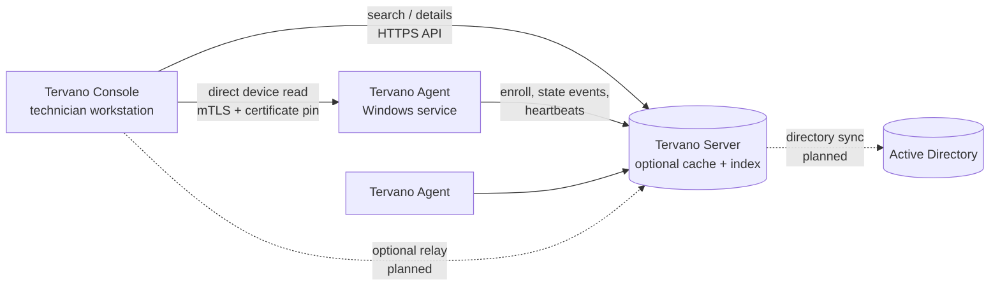

# Tervano — Open-Source Remote Administration & Endpoint Management

**One console. Every endpoint. No licensing barriers.**

Tervano is a free, self-hosted platform for IT departments, organizations and school systems to find, inspect and administer their Windows endpoints. It aims to combine EV Reach-style systems administration, remote desktop control, Active Directory management, live endpoint state, background troubleshooting, automation, an optional central cache, and Veyon-inspired classroom features in one native Rust application suite.

> **Status: early development (Phase 1).** What works today is the vertical slice *Agent → Server → Console*: agents enroll, report real hostname / OS / network / signed-in users, and technicians search and inspect them in a native GUI. Remote control, AD, and background administration are **not implemented yet**. Tervano does not have EV Reach parity and should not be used in production yet.

Tervano is for administering devices your organization is authorized to manage. Not affiliated with or endorsed by EasyVista, Goverlan, or Veyon.

## Architecture



- **Agent** (`TervanoAgent.exe`) — Windows service. Collects device state with native APIs (WTS sessions, registry, adapters), reports changes and heartbeats. Event `seq` numbers make retries idempotent and reject replays.
- **Server** (`tervano-server`) — optional. Indexes device state so searches ("which PC is *jdoe* on?") never hit domain controllers or every endpoint. Stores only SHA-256 hashes of enrollment tokens, device secrets and technician tokens.
- **Console** (`TervanoConsole.exe`) — native Iced app (no Electron/Chromium).

**Why the server is optional:** it accelerates discovery and centralizes policy; direct Console→Agent device reads already work during a server outage. Further direct operations are planned.

Architecture decisions: [Iced Console](docs/adr/0001-iced-console.md), [SQLite first](docs/adr/0002-sqlite-first.md), and [HTTP+JSON for Phase 1](docs/adr/0003-http-json-phase1.md).

## Feature status

Status labels: Implemented · Partial · In progress · Planned · Blocked · Unsupported. Full task list: [TASKS.md](TASKS.md).

| Category | Feature | Status | Platform | Notes |
|---|---|---|---|---|
| Agent | Background service | Partial | Windows | SCM install/run implemented ([service.rs](apps/agent/src/service.rs)); foreground mode verified on Win 11 25H2; service mode not yet verified end-to-end |
| Agent | Secure enrollment | Partial | Windows | One-time/N-use expiring tokens over TLS; device secret DPAPI-protected on the agent. Mutual TLS device identity is T-808 |
| Server | TLS | Implemented | Win/Linux | rustls; plaintext only on loopback. `tervano-server cert init` creates a private CA + server cert |
| Server | Audit log | Partial | Win/Linux | Append-only (DB triggers); enrollments, auth failures, token/technician creation. `GET /api/v1/audit` includes socket peer IP for HTTP events; behind a proxy this is the proxy IP |
| Agent | Report hostname, OS, IPs, signed-in users | Implemented | Windows | Verified on Windows 11 Home 25H2 (build 26200), workgroup machine. Not yet tested domain-joined |
| Agent | Change detection | Partial | Windows | Poll-and-diff every `poll_secs`; event-driven notifications are T-209/T-210 |
| Server | Device index + search | Implemented | Win/Linux | Prefix search by hostname, username, `DOMAIN\user`, IP. Tests: [api.rs](apps/server/tests/api.rs). Not yet benchmarked (T-112) |
| Server | Online/offline tracking | Implemented | Win/Linux | Heartbeat timeout + immediate offline on agent shutdown |
| Server | Device event history | Implemented | Win/Linux | Authenticated `GET /api/v1/devices/{id}/events`, newest first with `before` and `limit` (max 100). Startup/state/shutdown events only; heartbeat excluded. Rows older than `event_retention_days` (default 30) are purged at startup and hourly, including existing old rows on upgrade |
| Discovery | Find computers by hostname | Implemented | Windows | Via server |
| Discovery | Find computers by logged-in user | Implemented | Windows | From real agent session data, not AD attributes |
| Console | Search, device list, device details | Implemented | Windows | Loading / empty / error states |
| Console | Live device updates | Implemented | Windows | Server push (SSE): logons, IP changes, online/offline appear within seconds; falls back to 15 s polling when the stream is down |
| Agent | Direct (serverless) management listener | Partial | Windows | mTLS: technician client certs from the org CA, per-technician allowlist, agent cert pinned by fingerprint. Only device info is exposed so far |
| Console | Serverless mode (Direct page) | Implemented | Windows | Add agents by address, confirm their certificate fingerprint on first contact, then view live device info over mutual TLS. Pin changes are refused with a warning |
| Directory | Active Directory browsing | Planned | Windows | T-600+ |
| Remote | Screen viewing / remote input / user notification | Planned | Windows | T-500+ |
| Inventory | Hardware information | Planned | Windows | T-703 |
| Systems | Process / service / registry / event log management | Planned | Windows | T-700+ |
| Automation | Bulk actions | Planned | Windows | T-800+ |
| Classroom | Live thumbnail grid | Planned | Windows | T-900+ |

Competitor comparison: `docs/feature-matrix.md` (T-981, not written yet).

### Pricing: Tervano vs EV Reach

| Pricing dimension | Tervano | EV Reach / Goverlan |
|---|---|---|
| License | Apache-2.0, free | Proprietary commercial |
| Software license cost | $0 | Paid (quote-based on vendor site) |
| Technician seat limits | None enforced by Tervano | Licensed per technician |
| Endpoint limits | No software-enforced cap | Review current vendor plan terms |
| Self-hosted server | Free software | Subject to vendor licensing |
| Infrastructure / hosting | Your own costs | Contract/deployment-dependent |
| Commercial support | Community only; paid support not promised | Vendor-provided |

Indicative third-party listings (as cited in the project brief, **not verified current vendor quotes**, recorded 2026-10-14): Standard ≈ $40, Professional ≈ $90, Enterprise ≈ $170 per technician/month. EasyVista's [product page](https://www.easyvista.com/products/remote-it-support/) asks prospects to request a quote. Verification and worked 5/10/25-technician examples are T-982. Tervano's total cost of ownership is not zero: hosting, deployment and administration time still cost money.

## Quick start (development)

Prerequisites: Rust stable (MSVC toolchain on Windows), ~3 GB disk for the build.

```bash
cargo build --workspace
```

```bash
mkdir -p dev-data && cd dev-data
../target/debug/tervano-server token create     # prints an enrollment token
../target/debug/tervano-server tech create --name alice   # prints a technician token
../target/debug/tervano-server serve            # http://127.0.0.1:8470 (plaintext is loopback-only)
```

Create `dev-data/agent.toml` from [agent.example.toml](apps/agent/agent.example.toml) with `server_url = "http://127.0.0.1:8470"`, the enrollment token and `state_dir = 'agent-state'`, then:

```bash
../target/debug/TervanoAgent run agent.toml
```

Run `target/debug/TervanoConsole`, paste the technician token in Settings, and search.

**Agent as a Windows service** (elevated prompt): put `agent.toml` in `%ProgramData%\Tervano\Agent\`, then `TervanoAgent service install` and `sc start TervanoAgent`. Logs go to `%ProgramData%\Tervano\Agent\agent.log`. Remove with `TervanoAgent service uninstall`.

**Serving to other machines (TLS):** the server refuses a non-loopback `listen` without TLS, and agents/consoles refuse `http://` to anything but loopback.

```bash
tervano-server cert init --name tervano.corp.example --name 10.0.0.5   # writes tls/ca.pem, server.pem, keys
```

Set `listen`, `tls_cert = 'tls/server.pem'`, `tls_key = 'tls/server-key.pem'` in `server.toml` ([example](apps/server/server.example.toml)), copy `tls/ca.pem` to endpoints and set `ca_cert` in `agent.toml` and the Console's Settings. Keep `tls/ca-key.pem` private; re-run `cert init` to rotate the server cert under the same CA. With an enterprise PKI, use your own certificate and skip `ca_cert` (the Windows certificate store is trusted). Note: Windows `curl` (Schannel) needs `--ssl-no-revoke` with the private CA because it has no CRL.

**Serverless / direct management:** an agent can run with no server at all. Issue technician certificates from the CA (`tervano-server cert tech --name alice` — the server binary works as a pure CLI here, no database needed), copy `ca.pem` to endpoints, and add a `[direct]` section to `agent.toml` (see [agent.example.toml](apps/agent/agent.example.toml)). Knowing an agent's address grants nothing: a CA-issued client certificate is required and checked against `allowed_technicians`. In the Console, set your technician certificate and key under Settings, then add agents on the **Direct** page; on first contact the Console shows the agent's fingerprint for you to compare with `TervanoAgent direct-fingerprint` on that computer before trusting it.

**Firewall:** agents need outbound TCP to the server port (default 8470), and inbound TCP on the direct port (e.g. 8472) only if `[direct]` is enabled.

Installers (MSI) and Linux/container server packaging are planned (T-950–T-952, T-117).

## Development

See [AGENTS.md](AGENTS.md) for layout, conventions and the commands that must pass (`cargo test --workspace`, `cargo clippy … -D warnings`, `cargo fmt`). Work is coordinated through [TASKS.md](TASKS.md).

## Roadmap

Phases from [PLAN.md](PLAN.md) §16, tracked in detail in [TASKS.md](TASKS.md):

- [x] Phase 0 — workspace, protocol, config, migrations (CI and docs still open)
- [ ] Phase 1 — Agent → Server → Console slice (core, TLS, audit, DPAPI, live updates, serverless direct management done)
- [ ] Phase 2 — Remote control
- [ ] Phase 3 — Active Directory
- [ ] Phase 4 — Background administration
- [ ] Phase 5 — Automation & enterprise
- [ ] Phase 6 — Classroom
- [ ] Phase 7 — Parity & hardening

## Security & privacy

Intended model (PLAN §12): mutual authentication, TLS everywhere, per-operation authorization enforced on the agent, append-only audit, mandatory visible notification for any interactive remote session, classroom recording off by default. **Today** the Server uses TLS off loopback, bearer-token authentication, hashed secrets, and a limited append-only audit log. The Windows Agent protects its device secret with DPAPI; direct Console→Agent connections use mutual TLS and a pinned Agent certificate. Role-based access and mutual TLS device identity to the Server remain planned. See the [current security model](docs/security-model.md) for trust boundaries and known gaps. Report vulnerabilities privately to the maintainers (SECURITY.md is T-012).

## License

[Apache License 2.0](LICENSE).
